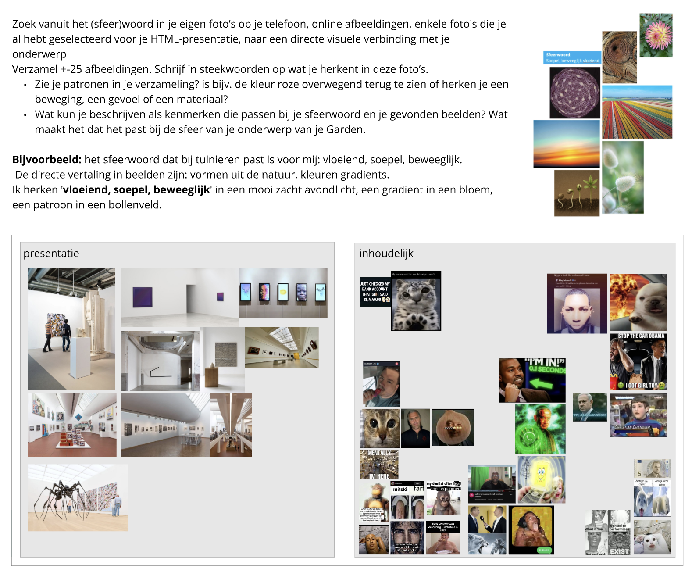
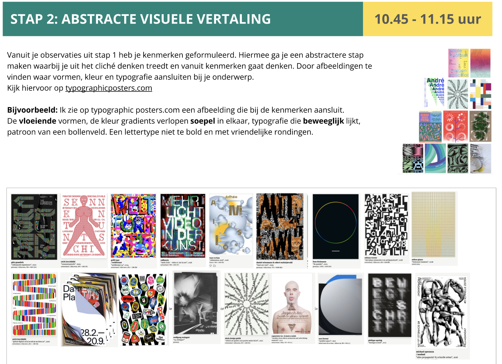
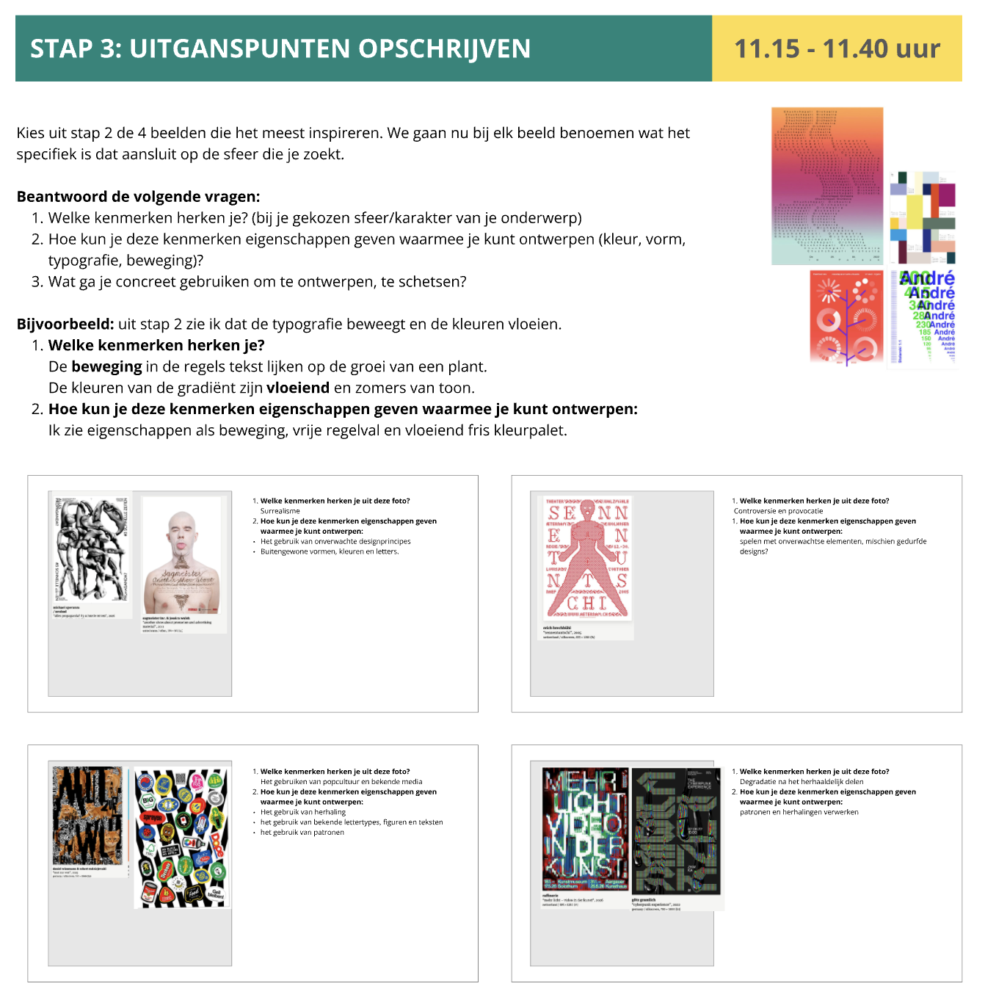

### Donderdag 26 november

Vandaag heb ik mijn laatste voorbereidingen gedaan aan de retrospective. Ik moet heel eerlijk zijn in de learning log, dus dat zal ik ook zijn. Ik ben veelste laat begonnen met het schrijven in html en eigenlijk aangeven dat ik er geen bal van begrijp. Justus heeft me heel erg geholpen hirmee. Ik heb W3schools, webdev, en paar gemini searches gebruikt om de code beter te begrijpen. En eerlijk gezegd is het nog niet af, omdat het niet proper reageert maar ik heb wel wat gedaan, en daar ben ik al redelijk trots op. er valt nog veel te doen echter.

### Woensdag 25 november

Deze les hebben we gekeken naar de vaktermen en het belang van de visuele vormgeving. De kern van de presentatie ging over het belang van vorm, cohesie en balans.Dit kan je vooral bereiken door het gebruiken van een consistent ontwerp systeem. Ik heb deze les schetsen gemaakt en heb gekeken naar welke Gestalt-principes verwerkt kunnen worden in mijn eindproduct. Ik heb besloten dat ik eigenlijk al veel had gedaan wat betreft de 3 principes (contrast, hiërarchie en witruimte). In mijn ontwerp kies ik ervoor om op mobiel een heel compact ontwerp te maken en op een groter scherm juist veel witruimte over te laten.

Ook had ik een zinnig gesprek met Justus waar ik veel waarde aan hechtte, namelijk het sentiment om juist te beginenn en dan om te kijken hoe ver je komt.

Noem 3 Gestalt- of Design-principes op en laat de ander uitleggen wat ze betekenen en doen.

1. Symmetrie, het spiegelen van foto’s en teksten. Een van de makkelijkste manieren om cohesie en rust op de website te creëren.
2. Ingevulde hiaten/Spelen met negatieve ruimte. Het suggereren van vormen die er niet daadwerkelijk zijn.
3. Balans. Het ervoor zorgen dat een pagina logisch opgemaakt is.
   Een grid biedt ruimte om te spelen (vrijheid), maar tegelijkertijd ook eenheid en structuur (vastigheid). Wat wordt hiermee bedoeld? 
   Werken in een grid geeft de ontwerper een vast ontwerpsysteem om in te bouwen. Dit zorgt voor een logische opstelling en geeft rust. Je bent echter wel vrij om te spelen met deze grid. Niet alles hoeft een perfect vierkant, en symmetrisch.
   Welk principe neem je mee in een laatste iteratie van je eigen Garden? 
   Ik denk dat het voor mij handig is om te werken in een grid, met meer aandacht voor de hiërarchie.

### Dinsdag 24 November

Deze dag heb ik vooral besteed aan het updaten van mijn readme. Ik heb foto's toegevoegd, en vooral paar teksten opnieuw gechreven. Ook heb ik de praticums waarop ik ahcterliep gedaan.

### Maandag 23 November

We begonnen vandaag met de bi-weekly geek. We hebben gediscussieerd over onderwerpen mbt. internet en de mens. We hebben een opdracht gemaakt waarin we vragen moeten stellen bij een hoofdvraag zodat we een meer genuanceerd antwoord kunnen vormen.
Het was voor deze opdracht ook belangrijk dat we wisten welke onderzoekmethodes het beste waren per vraag.

Leg uit wanneer een website 'lelijk' wordt en geef voorbeelden wat je kan doen om deze 'lelijke' onderdelen te fixen?
Wanneer een website tekst bevat die niet schaalbaar is en van het scherm verdwijnt. Het is ook belangrijk dat de foto’s en andere dingen ook schaalbaar blijven. Dit doe je door een grid of layout te gebruiken.
Vertel welke volgende stap je neemt om je website responsive te maken.
Het lijkt mij verstandig om inderdaad te gaan werken vanuit een grid en of een lay-out zodat het scherm mee schaalt.
Kun je het ontwerp en de bouw van je eigen Garden (zo uit je hoofd)
onderbouwen in Webby vocabulair?

### Vrijdag 20 November

Feedback: Met 1 gek element werken, werkt heel goed. Laat de website echter niet afhankelijk zijn van één functie og ontwerp. Als deze funtie niet werkt, is de kans groot dat de rest van de website ook niet zal werken.

### Woensdag 18 November

Op de woensdag hebben we gewerkt aan de visual research naar mijn website. We hebben in de les daarvoor een template op een MIRO bord. De link van het bord staat onderaan de dag. We begonnen de dag met een presentatite/pitch gedaan over ons onderwerp. Mijn gekozen onderwerp is: 'De hercontextualisering van absurde internetcultuur: Memes & Brainrot" de sfeerwoorden die ik heb gekozen zijn "Ruw, Anarchisme, Counterculture, Chaos, Waanzin, Dada" deze woorden heb gekozen omdat internetcultuur veel regels van bestaande kunstvormen over neemt. Het volgt geen regels, het vouwt geen doekjes en iedereen kan iets betekenen voor de scène. Memes en brainrot baseren zich op popcultuur, controverses, en op het absurde. Deze regels gelden ook voor het internet.

Deze crazy 8 heb ik gemaakt op basis van mijn sfeerwoorden namelijk Chaos en Waanzin. De beste ideën in de crazy 8 zijn idee 4 en idee 8. Een logisch schermbouwen met een of 2 absurde elementen. De uitgangspunten waren opzich wel te herleiden, aldus Claudia en Teun.
Is het idee online te vertalen? Hoe zouden vorm/ kleur of typografie in een schermontwerp kunnen worden getoond?
De gepresenteerde concepten zouden vertaald kunnen worden naar css, maar ik durf niet met zekerheid te zeggen hoe gemakkelijk dit is.
Wat betreft nieuwe technieken leren, is het antwoord ja. Ik leer bij elk stukje css iets nieuws, omdat ik vrijwel niks ken van html noch css.

![]
Checkout

1. Leg uit waar het Visual Research in 3 stappen naartoe werkt?
   -Analyseer je oorspronkelijke inspiratie, kijk wat je hebt gekozen en waarom
   -Abstraheer je inspiratie, zoek foto’s die aansluiten bij je originele idee
   -Schrijf je uitgangspunten op en kijk met wat je kan gaan ontwerpen.
1. Vertel in 2 zinnen waar jouw Garden over gaat, en met welke content je dat gaat doen (beeld, tekst, sound, animatie enz).
   Mijn onderwerp is de hercontextualisering van absurde internetcultuur: Memes & Brainrot, waarin ik foto’s van het internet opnieuw ga ontleden op een zinvolle en interessante manier. Tekst/foto’s
1. Vertel kort welk idee van de Crazy 8 je het liefst zou willen uitvoeren/ verder zou willen onderzoeken.Ik zou het liefste plan 4 en 8 uit willen werken.

Miro Link
https://miro.com/app/board/uXjVEPsWKDc=/?share_link_id=481559051952

### Dinsdag 17 November

### Maandag 16 November

Vandaag gingen we met de grote groep aan de slag met de betekenis achter een Digitale tuin. We gingen begrijpend lezen, en een artikel systematisch scannen. Verder hebben we websites geanalyseerd vanuit verschillende webringen om te beoordelen welke Webby zijn, en welke niet. Dit was nuttig,. omdat ik meteen kon oriënteren wat ik graag wou maken. Hier na hebben we onze eigen verkenning gedaan naar wat we graag zouden willen maken.

Ik heb hier al kort over nagedacht. Ik vond het vroeger ontzettend leuk om nieuwe dingen te leren en dan vooral via "buzzfeed" achtige lijstjes, waarin ze info op een tijdlijn, lijstje of ranking zetten. of andere dingen te beoordelen. Ik heb een grote intresse voor het internet. Waarschijnlijk ga ik zo iets maken.

Het onderwerp wat ik heb gekozen is het hercontextualisering van internet cultuur zoals memes en brainrot. De reden dat ik dit onderwerp heb gekozen is omdat ik dit aanschouw als een zeldzame intressante hobby. Tijdens doomcsrollen op verschillende platformen verzamel ik intressante media die ik zou kunnen schilderen. Ik ben namelijk van mening dat er een bepaalde kunst zit achter het maken van deze onzin. Door een combinatie van pop cultuur, ai, herkenbre thema's en photbashing resulteert in een absurde cultuur.

Checkout

1. Een digital Garden is een experimentele website wat tussen een website en blog is zit. De reden waarom het anders is dan die twee, is omdat een Blog lineair werkt, en omdat een website af is. Een DIgital garden is dat niet. Het is een altijd evoluerend concept wat elk moment uitgebreid zou kunnen worden.
2. Een webby website is een toegankelijke website voor mensen met een beperking, maar ook toegankelijk voor iedereen. HEr is een zelf ingerichte gevarieerde website. Het moet ook zich kunnen aanpassen aan de gebruikers instellingen. De websites die me gek genoeg het meeste inspireerde waren de websites die het gekste waren en juist niet aan de regels voldoen van een normale commerciële website. Katten met laserogen, prints en allerlei andere dingen. Het web is anarchistisch en wild, en de mogelijkheid om alles te maken motiveert erg.
3. Wat mij het meeste inspireerde waren ook de grote digitale collecties van informatie die mensen hebben. Collecties van furry art, kralenkettingen en busfoto's.
   ik ben geïnteresseerd om het zelfde te doen en een collectie maken van de kennis die ik bezit. Natuurlijk wel met een extra element, zodat het leuk blijft.
   De oneindige mogelijkheden zijn het meest motiverende element.

## Sprint 0

## 13 november

Ik heb deze dag gewerkt aan Schetsen en Interactie gedaan. Ik heb eerst schetsen gedaan, omdat de Docent voor interactie afwezig was. Het schetsen was niet nieuw voor mij, omdat ik al een achtergrond heb in illustratie. Toch was het even fijn om aan de slag te gaan en paar regels mee te nemen. Wat ik meeneem van het schetsen is het maken van duidelijke omlijningen, en het belang van annotaties bij schetsen. Meeste schetsen hebben annotaties nodig, behalve als ze heel, heel goed zijn.

Hieronder staan de schetsen die we hebben gemaakt als opdracht. Meeste van deze schetsen heb ik nog wat bij gekras, uit vermaak. Daarom zien de schetsen er waarschijnlijk ietsjes anders uit.

### 11 November 2026

Het is zover, we beginnen echt met de code. Het programma voor vandaag was Praktische CSS en Fonts met kleur en effect. Ik heb meegevolgd met de eerste opdracht, deze was makkelijk te volgen en te begrijpen. De code werd goed uitgelegd en ik denk dat ik wel een paar stukken code kan overnemen voor mijn eigen website. Bij Fonts en kleuren ging het wat moeilijker, omdat ik zelf code moest typen. Ik heb aan de hand van de uitleg mezelf proberen uit te leggen wat code doet en waarom.
Code gaat voor mij niet vanzelf, dus ik zal dit blok beter moeten bijbenen en onderzoek doen om hetzelfde resultaat als andere te krijgen.

### 9 November 2026

Vandaag was de launch van Het Web is voor iedereen. Ik vind dit wel ontzettend spannend omdat het blok veel om coderen draait, en ik dat nog niet zo goed kan. Ik sta wel open om het te leren. Het opzetten van de editor en website verliep al lastig, maar dat was omdat ik het verkeerd las.

Checkout
1 Een sourcehosting platform is een server (platform) waarop je je files, en uiteindelijk je website kan hosten. IK ehb er voor gekozen om Github te gebruiken omdat deze het meeste voor de hand lagen.
2 De domeinnaam die ik heb gekozen is "Mattijshuis.ml" Omdat dat ten eerste mijn naam is, maar ten tweede omdat ik nog niet zeker ben wat voor website ik wil bouwen. Ik wil niet "MattijsBouwbedrijven.nl" hebben, en dan er achter komen dat ik graag toch over bloemen wil schrijven.

# Einde van de log, heel erg bedankt voor het lezen :->
